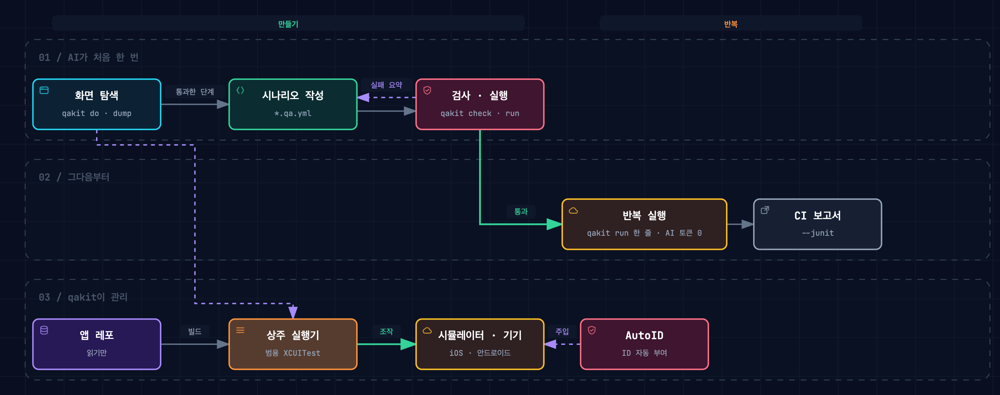

# qa-kit

<p align="center"></p>

모바일 앱 QA 시나리오를 만들고 돌리는 CLI `qakit`이에요.
iOS 시뮬레이터·실기기와 안드로이드 에뮬레이터에서 돌고, 브라우저 UI(`qakit ui`)와 맥 앱도 있어요.

- **앱 코드를 고치지 않아요.** iOS는 프로퍼티 이름으로 ID가 자동으로 붙어요 (`LoginView.loginButton`).
- **시나리오는 YAML 파일(`.qa.yml`)이에요.** 컴파일 없이 바로 돌아요.
- **AI는 처음 한 번만 써요.** 만든 뒤에는 `qakit run` 한 줄로, 토큰 없이 계속 돌려요.

왜 이렇게 만들었는지는 [docs/why.md](docs/why.md)에 있어요.

## 목차

- [설치](#설치)
- [5분 시작](#5분-시작)
- [시나리오 예시](#시나리오-예시)
- [자주 쓰는 명령](#자주-쓰는-명령)
- [웹 UI와 맥 앱](#웹-ui와-맥-앱)
- [AI와 함께 쓰기](#ai와-함께-쓰기)
- [더 보기](#더-보기)

## 설치

먼저 아래 도구가 있는지 확인해 주세요.

| 필요한 것 | 확인 |
|---|---|
| macOS + Xcode 16 이상 | `xcodebuild -version` |
| Python 3 (macOS 기본) | `python3 --version` |
| XcodeGen | `brew install xcodegen` |
| 안드로이드만 쓸 때 | `qakit android setup`이 JDK·SDK·에뮬레이터를 설치해요 |

```bash
git clone -b main https://github.com/indextrown/qa-kit.git ~/qa-kit
~/qa-kit/bin/qakit install-skill     # qakit 명령 + Claude Code·Codex 스킬 설치
```

| 하고 싶은 것 | 명령 |
|---|---|
| 업데이트 | `qakit update` |
| 버전 확인 | `qakit --version` |
| 제거 | `qakit install-skill --uninstall` |

> **맥 앱(미리 보기)**: 터미널 없이 창으로 쓰고 싶다면 [릴리스](https://github.com/indextrown/qa-kit/releases/latest)의 `QA-Kit-<버전>.dmg`를 열어 Applications로 끌어 놓으세요. 공증 전이라 [처음 열 때 한 번 허용](docs/web-ui.md#맥-앱-미리-보기)해야 해요. Xcode·XcodeGen은 똑같이 필요해요.

설치 위치와 옛 이름(`ios-qa-kit`)에서 옮기는 방법은 [시작 가이드](docs/getting-started.md#1단계-설치)를 봐 주세요.

## 5분 시작

### iOS

```bash
qakit init ~/path/to/MyApp --worktree   # QA 전용 워크트리(MyApp-qa) + 작업공간(QA/)
cd ~/path/to/MyApp-qa/QA
qakit doctor                            # 환경 점검 (❌가 있으면 안내대로)
qakit build-app                         # 앱 빌드 → 시뮬레이터 설치
qakit do launch                         # 앱 띄우기
qakit do dump                           # 지금 화면 구조(ID·라벨)를 텍스트로
qakit do 'tap: LoginView.loginButton'   # 한 단계씩 눌러 보기
qakit do save login-check               # 통과한 단계로 시나리오 초안
qakit run login-check                   # 실행
```

- 로그인이 필요하면 `cp secrets.example.txt secrets.txt`로 파일을 만들고 계정을 넣어 주세요.
- 단계별 설명은 [시작 가이드](docs/getting-started.md)에 있어요.

### 안드로이드 (미리 보기)

```bash
qakit android setup      # JDK·SDK·에뮬레이터·AVD (Android Studio 없이)
qakit android boot       # 에뮬레이터 띄우기
qakit android dump       # 지금 화면 구조 (작업공간 없이)
```

작업공간 `qakit.yml`에 `platform: android`를 적으면 `build-app`·`run`·`do`를 그대로 쓸 수 있어요.
설정 예시와 한계는 [docs/android.md](docs/android.md)에 있어요.

## 시나리오 예시

`scenarios/search.qa.yml`

```yaml
name: 검색 결과에서 첫 항목 상세 열기
reset: true                    # 앱 초기화부터
tags: [smoke]
vars: { item: 커피 }
steps:
  - use: login                 # steps/login.qa.yml (공통 단계)
  - tap: HomeView.searchButton
  - type: { into: SearchView.searchField, text: "{item}" }
  - tap: { id: ResultCell.nameLabel, contains: "{item}" }
  - expect: { visible: DetailView.title }
    timeout: 10
```

```bash
qakit check search                  # 형식 + ID가 앱에 있는지 (실행 없이)
qakit run search --var item=라떼    # 값을 바꿔 실행
```

실패하면 원인, 마지막 단계, 그 순간의 화면 구조를 텍스트로 보여 줘요. 사람도 AI도 이것만 보고 고칠 수 있어요.

- 문법 전체: [scenario-language.md](skills/qa-kit/references/scenario-language.md)
- 상주 실행기·CI: [docs/scenarios.md](docs/scenarios.md)

## 자주 쓰는 명령

작업공간 폴더에서 실행해요.

| 하고 싶은 것 | 명령 |
|---|---|
| 앱 빌드·설치 | `qakit build-app` |
| 시나리오 하나 실행 | `qakit run <시나리오>` |
| 여러 개를 빠르게 | `qakit run 'home-*' --reuse-app` |
| 태그로 골라 CI 보고서 | `qakit run --tag smoke --junit report.xml` |
| 실행 없이 검사 | `qakit check` |
| 한 단계씩 눌러 보기 | `qakit do '<단계>'` · `qakit do dump` |
| 눌러 본 단계를 시나리오로 | `qakit do save <이름>` |
| 마지막 실패 다시 보기 | `qakit summarize` |
| 아직 안 쓴 ID 보기 | `qakit coverage --unused` |
| 실기기에서 | `qakit run <시나리오> --device` |
| 성능 측정 | `qakit run <시나리오> --bench 5m` |
| 브라우저 UI | `qakit ui` |

| 종료 코드 | 뜻 |
|---|---|
| `0` | 통과 |
| `1` | 앱 판정 실패 |
| `2` | 환경·설정 문제 |

전체 명령은 [docs/commands.md](docs/commands.md), 옵션까지는 [cli.md](skills/qa-kit/references/cli.md)에 있어요.

## 웹 UI와 맥 앱

```bash
qakit ui            # 브라우저가 열려요. 끄려면 Ctrl+C
```

| 메뉴 | 할 수 있는 것 |
|---|---|
| 라이브 세션 | 시뮬레이터 화면을 보며 눌러 조작하고 시나리오로 저장 |
| AI | 말로 시키면 AI가 앱을 조작하고 답함 (대화 · 맡기기 · 시나리오로) |
| 시나리오 | 골라서(태그로 한꺼번에) 실행, 실시간 로그 |
| 커버리지 | 화면별로 시나리오가 쓰는 ID 비율 |
| 편집 | 시나리오 YAML 편집 (고칠 때마다 검사) |
| 실행 기록 | 통과·실패, 원인·스크린샷·실패 영상 |

- 웹 UI는 `127.0.0.1`에만 열려요.
- 맥 앱(미리 보기)을 켜면 작업공간을 고르고 같은 웹 UI를 창으로 열어요. 서버는 앱이 켜고 꺼요.
- 자세한 내용은 [docs/web-ui.md](docs/web-ui.md)에 있어요.

## AI와 함께 쓰기

`install-skill`이 Claude Code(`/qa-kit`)와 Codex(`$qa-kit`) 스킬을 설치해요.

1. 작업공간 폴더에서 "로그인하면 홈이 뜨는지 확인하는 테스트 만들어줘"처럼 요청해요.
2. AI가 화면을 탐색해 시나리오를 쓰고, 통과할 때까지 고쳐요.
3. `qakit mcp install --claude`로 MCP 서버를 붙이면 AI가 앱을 직접 눌러 보며 QA해요.

자세한 내용은 [docs/ai.md](docs/ai.md)에 있어요.

## 더 보기

| 문서 | 내용 |
|---|---|
| [시작 가이드](docs/getting-started.md) | 준비물, 1~8단계, 처음 쓸 때 알아 둘 것, 저장과 복구 |
| [왜 qa-kit인가](docs/why.md) | 구조 그림, XCUITest만 쓸 때와 비교, 컴파일이 필요 없는 이유 |
| [시나리오·상주 실행기·CI](docs/scenarios.md) | `.qa.yml`, `qakit serve`·`qakit do`, GitHub Actions |
| [웹 UI](docs/web-ui.md) | 라이브 세션, 툴바, QA 브랜치 최신화, 맥 앱 |
| [AI로 QA하기](docs/ai.md) | MCP 도구, AI QA, AI로 시나리오 만들기 |
| [실기기](docs/device.md) | `--device`, 서명, 성능 측정(`--bench`) |
| [안드로이드](docs/android.md) | 설정, 명령, 한계 |
| [동작 원리](docs/how-it-works.md) | 작업공간 구조, 자동 ID 규칙, 요소 찾는 순서, 앱이 바뀌었을 때, 원칙과 한계 |
| [실시간 화면](docs/live-screen.md) | 시뮬레이터 화면을 영상으로 보여 주는 원리, 측정 |
| [비공개 API](docs/private-apis.md) | 화면 메모리·프레임 콜백·터치 주입에 쓰는 시뮬레이터 내부 API, Xcode가 바뀌면 조사하는 법 |
| [비공개 API 조사 방법](docs/reverse-engineering.md) | 역어셈블·Swift 심볼·런타임·시뮬레이터 안 로그·충돌 보고서·XPC로 알아내는 순서와 지킬 것 |
| [명령 요약](docs/commands.md) | 모든 명령과 전역 옵션 |
| [개발·기여](docs/development.md) | 레포 구조, 테스트, Git Flow, 검증 현황 |

레퍼런스 (스킬과 같이 써요): [cli.md](skills/qa-kit/references/cli.md) · [scenario-language.md](skills/qa-kit/references/scenario-language.md) · [qakit-api.md](skills/qa-kit/references/qakit-api.md) · [troubleshooting.md](skills/qa-kit/references/troubleshooting.md)

README 상단 그림의 원본은 [`docs/images/qakit-flow-dark.archify.json`](docs/images/qakit-flow-dark.archify.json)이에요 (archify로 그렸어요).
