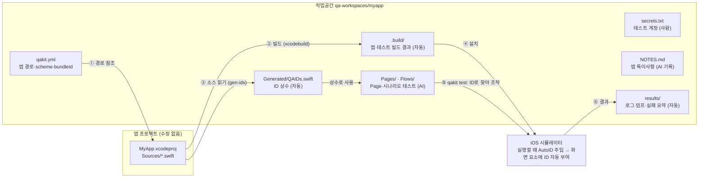

# ios-qa-kit

**앱 코드를 한 줄도 고치지 않고** iOS 앱에 XCUITest를 붙이고, AI가 테스트를 만들고 고치게 하는 도구입니다.

> **한 줄 요약** — AI가 시나리오를 한 번 테스트로 만들어 두면, 이후에는 `qakit test` 한 줄로 토큰 없이 계속 돌립니다.
> computer use(스크린샷 보며 조작)처럼 매번 AI 비용이 들지 않습니다.

| 무엇을 | 어떻게 |
|---|---|
| 화면 요소 찾기 | 시뮬레이터에서 실행할 때 라이브러리를 끼워 넣어 `LoginView.loginButton` 같은 **ID를 자동으로** 붙입니다 (Swift 프로퍼티 이름 기반) |
| 앱 변경에 강하게 | 앱 소스에서 ID를 **Swift 상수(`QAID`)** 로 만들어, 이름이 바뀌면 컴파일 에러로 바로 알려 줍니다 |
| 실행·실패 분석 | `qakit` 명령 하나로 빌드·설치·실행·실패 요약까지. 요약은 텍스트라 AI가 스크린샷 없이 고칩니다 |
| AI 작업 | Claude Code / Codex **스킬**: "이 시나리오 테스트 만들어줘" → 작성하고 통과할 때까지 수정 |

## 목차

| 시작하기 | 이해하기 | 참고 |
|---|---|---|
| [준비물](#준비물)<br>[빠른 시작](#빠른-시작)<br>[시나리오 파일로 QA](#시나리오-파일로-qa-swift-없이)<br>[저장과 복구](#저장과-복구-ai-없이) | [전체 흐름 한눈에](#전체-흐름-한눈에)<br>[자동으로 붙는 ID 규칙](#자동으로-붙는-id-규칙)<br>[UI 요소를 찾는 우선순위](#ui-요소를-찾는-우선순위)<br>[앱이 바뀌었을 때](#앱이-바뀌었을-때) | [명령 요약](#명령-요약) · [원칙](#원칙) · [한계](#한계)<br>[레포 구조](#레포-구조) · [기여하기](#기여하기) · [검증 현황](#검증-현황) |

---

## 준비물

| 항목 | 확인 |
|---|---|
| macOS + Xcode (16 이상, 26.6에서 검증) | `xcodebuild -version` |
| iOS 시뮬레이터 | `xcrun simctl list devices available` |
| Python 3 (macOS 기본) | `python3 --version` |
| XcodeGen | `brew install xcodegen` |
| UIKit 앱 | SwiftUI 화면은 자동 ID가 붙지 않습니다 (아래 [한계](#한계) 참고) |

---

## 빠른 시작

처음 한 번, 약 10분. 아래 순서대로 따라 하면 첫 테스트까지 돌아갑니다.

### 1. 설치

```bash
git clone -b main https://github.com/indextrown/ios-qa-kit.git ~/ios-qa-kit   # 비공개 레포: 접근 권한 필요
~/ios-qa-kit/bin/qakit install-skill
```

`install-skill`은 다음을 **심볼릭 링크**로 설치합니다 (레포를 고치면 바로 반영, 제거는 `--uninstall`).

- `qakit` 명령 → `~/.local/bin/qakit` (PATH에 없으면 안내가 나옵니다)
- Claude Code 스킬 → `~/.claude/skills/ios-qa-kit` (`/ios-qa-kit`)
- Codex 스킬 → `~/.agents/skills/ios-qa-kit` (`$ios-qa-kit`)

### 2. 앱에 QA 워크트리 만들기 (권장)

```bash
qakit init ~/path/to/MyApp --worktree
cd ~/path/to/MyApp-qa/QA
```

- 앱 레포에 **QA 전용 git 워크트리** `MyApp-qa`(브랜치 `qa/workspace`, `develop`에서 생성)를 만들고, 그 안 `QA/` 폴더에 작업공간을 만듭니다. 원래 개발 폴더와 섞이지 않고, 이름이 `-qa`라 다른 워크트리와 헷갈리지 않습니다.
- 키가 든 xcconfig처럼 **git에 없는 작은 로컬 설정 파일**은 원래 폴더에서 워크트리로 복사합니다 (없으면 빌드가 실패하므로).
- `QA/`는 이 PC의 git 무시 목록(`.git/info/exclude`)에 들어갑니다. 팀이 커밋하기로 하면 `QA/.gitignore`가 생성물·비밀값을 이미 제외하고 있으니 그대로 커밋하면 됩니다.
- scheme·configuration·bundle ID는 자동으로 찾아 `qakit.yml`에 적습니다. 확인하고 필요한 권한을 넣으세요:

```yaml
app:
  project: ../MyApp.xcodeproj        # 워크트리의 앱 (상대 경로)
  scheme: MyApp-Dev
  bundleId: com.example.myapp.dev
permissions: [location-always]       # 테스트 전에 미리 허용할 권한
```

> 워크트리를 쓰지 않으려면: `qakit init <앱>`(앱 옆 `qa-workspaces/<이름>`) 또는 `--in-project`(앱 폴더 안 `QA/`).

### 3. 점검 → 빌드 → 첫 화면 보기

```bash
cd ~/path/to/qa-workspaces/myapp
qakit doctor        # ❌가 있으면 → 안내대로
qakit build-app     # 앱 빌드 + 시뮬레이터 설치 (처음엔 몇 분)
qakit dump-ui       # 첫 화면 구조 → results/ui-dump.txt
```

`results/ui-dump.txt` 맨 위에 **ID 커버리지**(누를 수 있는 요소 중 ID가 붙은 비율)가 나옵니다.

- `dump-ui`는 앱을 새로 띄워 **처음 보이는 화면**을 덤프합니다. 로그인돼 있으면 로그인 화면이 아니라 홈 화면(또는 그 위의 팝업)이 잡힙니다.
- 특정 요소가 뜰 때까지 기다리려면 `--wait-id <ID>` (30초 안에 안 뜨면 실패), 테스트로 원하는 화면까지 간 뒤 그 화면을 보려면 `qakit dump-ui --attach`.
- 화면 위에 팝업이 떠 있으면 **아래 화면 요소가 덤프에서 사라집니다.** 커버리지가 이상하게 낮으면 덤프 맨 아래쪽(최상단 요소)을 보세요.

```text
# interactive: 8, with auto/app ID: 8 (100%)
Button #LoginView.loginButton "로그인" @16,682 370x56
TextField #LoginView.emailField.textField @28,496 346x28
```

### 4. 로그인이 필요한 앱이면 계정 넣기

```bash
cp secrets.example.txt secrets.txt    # git에 올라가지 않습니다
```

```text
EMAIL=qa@example.com
PASSWORD=...
```

키 이름은 자유입니다. `secrets.example.txt`에 적은 키는 `qakit doctor`가 빠졌는지 검사합니다.

### 5. 첫 테스트

**AI에게 맡기기 (권장)** — 작업공간 폴더에서 Claude Code / Codex를 열고:

```text
/ios-qa-kit 로그인 화면에서 테스트 계정으로 로그인하면 홈 화면이 뜨는지 확인하는 테스트 만들어줘
```

AI는 스킬 규칙대로 ID 상수를 찾고, Page와 테스트를 만들고, `qakit test`가 통과할 때까지 고칩니다.

**직접 쓰기** — `Runner/UITests/Pages/LoginPage.swift`

```swift
import QAKit
import XCTest

final class LoginPage: BasePage {
    override var anchor: XCUIElement { el(QAID.LoginView.loginButton) }      // 이 화면의 대표 요소
    var email: XCUIElement { app.textFields[QAID.LoginView.emailField.textField] }
    var password: XCUIElement { app.secureTextFields[QAID.LoginView.passwordField.textField] }
}
```

`Runner/UITests/Flows/LoginTests.swift`

```swift
import QAKit
import XCTest

final class LoginTests: QATestCase {
    func test_login() throws {
        launchApp()
        let page = LoginPage(app).waitUntilDisplayed()
        try step("로그인 입력") {
            page.email.clearAndType(try QASecrets.require("EMAIL"))
            page.password.clearAndType(try QASecrets.require("PASSWORD"))
            page.anchor.tap()
        }
        XCTAssertTrue(HomePage(app).isDisplayed(timeout: 20), "로그인 후 홈 화면이 떠야 함")
    }
}
```

```bash
qakit test LoginTests
```

새 파일은 자동으로 프로젝트에 포함됩니다. 실패하면 원인·마지막 단계·실패 시점 화면 구조가 바로 출력됩니다.

### 6. 실패를 읽고 고쳐 보기

```bash
qakit test                 # 전체 실행
qakit summarize            # 마지막 실패 요약 다시 보기
```

실패 요약은 이렇게 나옵니다. AI도 이것만 읽고 고칩니다.

```text
❌ LoginTests/test_login()
   원인: 로그인 후 홈 화면이 뜨지 않음. 화면 안내: 팝업: 이미 다른 기기에서 로그인 중입니다…
   마지막 단계:
     - 로그인 입력
   실패 시점 화면 구조 (ID/라벨 있는 요소):
     Button, identifier: 'AlertView.confirmButton', label: '로그인'
   스크린샷: results/test-…-attachments/….png
```

- 체험: `Pages/`에서 `QAID` 상수 하나를 없는 이름으로 바꿔 보세요. 실행 전에 **컴파일 에러**로 막히고 위치가 출력됩니다.
- 새 작업공간의 `NOTES.md`는 비어 있습니다. 로그인 후 공지·권한 팝업처럼 앱마다 다른 것은 AI가 실패를 통해 찾아 고치고 `NOTES.md`에 적습니다. 다음 세션의 AI는 그걸 먼저 읽습니다.
- 로그아웃 상태부터 확인하는 테스트는 `qakit test --reset <테스트>` (앱 재설치 + 키체인 초기화).

### 7. 앱이 바뀌었을 때 체험 (선택)

```bash
qakit --app ~/path/to/MyApp-other-branch test    # 다른 브랜치 폴더(git worktree)로 테스트 → 자동 재빌드
qakit test                                       # 원래 앱으로 돌아오면 다시 자동 재빌드
```

자세한 내용: [앱이 바뀌었을 때](#앱이-바뀌었을-때)

### 8. 정리

```bash
rm -rf ~/path/to/qa-workspaces/myapp-practice
```

시뮬레이터에 설치된 앱은 그대로 둬도 됩니다. 다른 작업공간에서 다음 `qakit test`를 하면 그 작업공간 기준으로 다시 맞춥니다.

### 처음 쓸 때 알아 둘 것

| 상황 | 알아 둘 것 |
|---|---|
| qakit을 동시에 두 개 실행 | 한 시뮬레이터에서 두 실행이 같은 앱을 조작하면 입력이 섞입니다(예: 이메일이 두 번 입력됨). **qakit이 시뮬레이터마다 잠금을 걸어**, 다른 실행이 있으면 누가 돌리는지 알려 주고 끝날 때까지 기다립니다 |
| 새 작업공간의 첫 `build-app` | 작업공간마다 빌드 폴더가 따로라서 처음엔 몇 분 걸립니다. 이후는 바뀐 부분만 |
| 로그인 테스트가 다른 기기를 로그아웃시킴 | 동시 로그인 기기 수 제한이 있는 앱이면 테스트 로그인이 다른 기기 세션을 끊을 수 있습니다. QA 전용 계정을 쓰고, 이런 동작은 사람이 승인한 뒤 `NOTES.md`에 기록합니다 |
| 권한 팝업(위치·사진 등)이 테스트를 막음 | `qakit.yml`의 `permissions`에 넣고 `qakit build-app`을 다시 실행 |
| 내가 쓰는 qakit 버전 | `qakit --version` (버전과 도구 폴더의 브랜치) |

---

## 시나리오 파일로 QA (Swift 없이)

AI가 Swift 대신 **시나리오 파일**(`QA/scenarios/<이름>.qa.yml`)을 쓰면, 도구 안의 범용 실행기가 그 파일을 읽어 그대로 실행합니다. 앱마다 QA용 Xcode 프로젝트를 만들거나 컴파일하지 않습니다.

```yaml
name: 검색한 상품을 즐겨찾기에 넣고 지도 모드로 보기
reset: true                               # 앱 초기화부터
vars: { item: 커피 }
steps:
  - use: login                            # steps/login.qa.yml (공통 단계)
  - tap: HomeView.menuButton
  - tap: { cell: MenuCell, has: { id: MenuCell.titleLabel, label: 검색 } }
  - input: { tap: SearchView.searchField, alert: "{item}", confirm: 완료 }
  - read: { from: { id: ResultCell.infoLabel }, pattern: '/(\d+)$', as: code }
  - unless: { exists: { id: ResultCell.favoriteBadge } }           # 이미 즐겨찾기면 누르지 않음
    then: [ tap: { id: ResultCell.nameLabel, contains: "{item}" } ]
  - expect: { selected: { segment: SettingView.modeControl, label: 지도 } }
    hold: 5
  - pinch: { on: HomeView.mapView, scale: 2.5 }
```

```bash
qakit check search-favorite      # 형식 + 적힌 ID가 앱에 있는지 (실행 없이, Swift의 컴파일 에러 역할)
qakit run search-favorite        # 실행 (reset: true면 앱 초기화부터)
```

- 단계·대상·조건 전체 문법: [scenario-language.md](skills/ios-qa-kit/references/scenario-language.md)
- 분기(`if`/`unless`), 값 읽기(`read`), 여러 후보 대기(`wait-any`), 위치 비교(`right-of`), 화면 변화(`changed`)까지 표현합니다.
- **화면에 안 나오는 앱 상태**(예: 지도 줌)는 앱 설정(UserDefaults) 값으로 판정하고(`pref`, `read-pref`), 목표 값까지 반복합니다(`repeat` + `watch`). 예: "줌 15가 될 때까지 핀치".
- 언어로 표현이 안 되는 계산·판정만 Swift(`QA/Runner/UITests/Flows`)로 씁니다. 두 방식은 같은 작업공간에서 함께 씁니다.

---

## 저장과 복구 (AI 없이)

**AI는 QA를 만들 때만** 씁니다. 만들어진 결과물을 저장해 두면, 작업공간을 지워도 **AI 없이 그대로 복구**됩니다.

```bash
qakit save -m "즐겨찾기 시나리오 추가"    # qa.lock.json(파일 목록·해시) + 보관소 ~/.qakit/archive/<이름>/
rm -rf QA                                     # 지워도
qakit restore --from myapp --to QA           # 보관소에서 복사 → ID 재생성 → 앱 빌드·설치 → 해시 확인
qakit run search-favorite                     # 바로 실행
qakit history                                 # 실행 기록: 언제·어느 앱 커밋에서·무엇이 통과/실패
```

| 저장되는 결과물 (save·restore 대상) | 저장 안 함 (restore가 다시 만듦) |
|---|---|
| `scenarios/`, `steps/`, `Runner/UITests/Pages·Flows`, `NOTES.md`, `qakit.yml`, `history.jsonl`, `qa.lock.json` | `QAIDs.swift`, Runner 프로젝트, `.build/`, `results/` |
| | `secrets.txt` (보안상 제외 → 복구 후 다시 넣기) |

- `QA/`를 git에 커밋하는 팀은 보관소 없이 커밋된 파일만으로 같은 복구가 됩니다 (`qakit restore`).
- `qa.lock.json`에 저장 시점의 도구 버전·앱 브랜치/커밋·파일 해시가 남아, 복구한 파일이 저장 때와 같은지 확인합니다.

---

## 전체 흐름 한눈에

### 세 곳: 앱 · 도구 · 작업공간

| 곳 | 예시 위치 | 들어 있는 것 | 누가 바꾸나 |
|---|---|---|---|
| **앱 프로젝트** (기존 그대로) | `~/work/MyApp` | 앱 소스. **복사하지 않고 경로만 참조**합니다 | 아무도 (qakit은 읽기만) |
| **도구** (이 레포) | `~/ios-qa-kit` | qakit CLI, 자동 ID 라이브러리, QAKit, 스킬, 템플릿 | 도구 개발자 ([docs/gitflow.md](docs/gitflow.md)) |
| **작업공간** (앱별 QA 폴더) | `~/work/qa-workspaces/myapp` | 설정·계정·테스트·빌드 결과. git으로 관리하지 않는 일회용 | 사람(설정·계정) + AI(테스트) + qakit(자동 생성) |



그림이 안 보이는 환경(터미널 등)이면:

1. `qakit.yml`에 적힌 경로로 앱 프로젝트를 **참조만** 합니다 (복사·수정 없음).
2. 앱을 빌드하고, 결과는 작업공간의 `.build/`에 저장합니다.
3. 앱 소스를 읽어 ID 상수 `Generated/QAIDs.swift`를 만듭니다.
4. 빌드한 앱을 시뮬레이터에 설치합니다. 실행할 때 AutoID를 끼워 넣어 화면 요소에 ID를 자동으로 붙입니다.
5. AI가 만든 Page·테스트가 ID 상수로 요소를 찾아 조작합니다 (`qakit test`).
6. 로그·덤프·실패 요약은 작업공간의 `results/`에 남습니다.

### 기존 프로젝트를 가져오는 방법

**앱 프로젝트는 복사하거나 고치지 않습니다.** `qakit init`이 앱 경로를 `qakit.yml`에 적어 두고, 이후 모든 명령은 그 경로를 읽기만 합니다.

| 단계 | 명령 | 앱 프로젝트에 하는 일 | 결과가 저장되는 곳 |
|---|---|---|---|
| 연결 | `qakit init ~/work/MyApp` | `xcodebuild -list`로 scheme·bundle ID 읽기 | 작업공간 생성, `qakit.yml`에 경로 기록 |
| 빌드 | `qakit build-app` | `xcodebuild build` (패키지 버전 고정, 빌드 전후 git 상태 비교 → 바뀌면 경고) | `작업공간/.build/app/` → 시뮬레이터에 설치 |
| ID 상수 | `qakit gen-ids` (`sync`·`test`가 자동 실행) | `*.swift` 읽기 (Pods·Tests 제외) | `작업공간/Runner/UITests/Generated/QAIDs.swift` |
| 실행 | `qakit test` | 없음 (설치된 앱을 실행, 자동 ID 라이브러리를 끼워 넣음) | `작업공간/results/` |
| 앱 변경 감지 | `qakit test` 시작 시 | `git` 브랜치·커밋·미커밋 변경 읽기 | `작업공간/.qakit/` (마지막 빌드 상태) |

- 다른 브랜치를 검증하려면 앱을 옮기지 말고 그 브랜치 폴더(git worktree)를 가리킵니다: `qakit --app ~/work/MyApp-release test`. 빌드 결과는 경로별로 따로 저장됩니다.
- 같은 앱에 작업공간을 여러 개 만들어도 됩니다 (예: 연습용, 기능별). 작업공간을 지워도 앱에는 아무 영향이 없습니다.

### 테스트가 처음부터 만들어지는 과정

| # | 누가 | 하는 일 | 만들어지는 것 |
|---|---|---|---|
| 1 | 사람 | `qakit init <앱>` → `qakit.yml` 확인(권한 등) → `secrets.txt`에 계정 | 작업공간, 기본 테스트(`SmokeTests`) |
| 2 | qakit | `build-app`: 앱 빌드·설치·권한 허용 / `dump-ui`: 첫 화면 구조 | `.build/`, `results/ui-dump.txt` |
| 3 | 사람 | AI에게 시나리오를 한 문장으로 요청: `/ios-qa-kit 로그인 후 홈이 뜨는지 확인해줘` | — |
| 4 | AI | `NOTES.md`·기존 공통 단계 읽기 → `QAIDs.swift`에서 화면 ID grep → 필요하면 앱 소스·덤프 확인 | — (읽기만) |
| 5 | AI | 화면마다 Page, 시나리오 테스트, 여러 테스트가 쓸 공통 단계 작성 | `Pages/LoginPage.swift`, `Flows/LoginTests.swift`, `Flows/AuthSteps.swift` |
| 6 | AI ↔ qakit | `qakit test` → 실패하면 텍스트 요약(원인·마지막 단계·그 순간 화면 구조)을 읽고 수정 → 통과할 때까지 (같은 원인 3번이면 멈추고 사람에게 보고) | 통과하는 테스트 |
| 7 | AI | 새로 알게 된 것(뜨는 팝업, 상태 판별 기준, ID 없는 영역, 사람의 결정)을 기록 | `NOTES.md` |
| 8 | 사람 | 다음 시나리오 요청. AI는 이미 있는 공통 단계(예: `ensureLoggedIn()`)를 재사용 | 시나리오가 쌓일수록 빨라짐 |

이후에는 사람·AI 없이 `qakit test`만 반복하면 됩니다 (토큰 0). 앱이 바뀌면 `qakit test`가 먼저 재빌드·ID 재생성을 하고, 깨진 테스트는 다시 AI에게 "`qakit sync` 결과대로 고쳐줘"라고 맡깁니다.

### 누가 무엇을 만드나

| 파일 | 만드는 쪽 | 설명 |
|---|---|---|
| `qakit.yml` | qakit 초안 → 사람 확인 | 앱 경로, scheme, bundle ID, 시뮬레이터, 미리 허용할 권한 |
| `secrets.txt` | **사람만** | 테스트 계정. AI는 값을 열어 보지 않고 `QASecrets`로만 씁니다 |
| `Pages/*Page.swift` | AI | 화면 하나 = Page 하나. 화면 대표 요소(anchor)와 요소·동작. ID는 여기에만 |
| `Flows/*Tests.swift` | AI | 시나리오 테스트. Page만 사용 |
| `Flows/*Steps.swift` | AI | 여러 테스트가 쓰는 공통 단계 (로그인, 메뉴 열기 …) |
| `NOTES.md` | AI (사람도 가능) | 앱 특이사항. 다음 세션의 AI가 먼저 읽습니다 |
| `Generated/QAIDs.swift` | qakit (자동) | 앱 소스에서 만든 ID 상수. 직접 고치지 않습니다 |
| `Runner/project.yml`, `Host/`, `QAKit/` | qakit (템플릿) | 테스트 실행용 Xcode 프로젝트 틀. 손대지 않습니다 |
| `.build/`, `results/`, `.qakit/` | qakit (자동) | 빌드 결과, 로그·덤프·실패 요약, 마지막 빌드 상태 |

시나리오가 몇 개 쌓인 작업공간 예:

```text
qa-workspaces/myapp/
├── qakit.yml  secrets.txt  NOTES.md  AGENTS.md  CLAUDE.md
├── Runner/UITests/
│   ├── Pages/        LoginPage  HomePage  MenuPage  SearchPage       ← AI
│   ├── Flows/        AuthSteps  MenuSteps                            ← AI (공통 단계)
│   │                 LoginTests  MenuTests  SearchTests  SmokeTests  ← AI (시나리오)
│   ├── Generated/    QAIDs.swift                                     ← 자동
│   └── QAKit/        QAKitDumpTests.swift                            ← 템플릿
├── .build/  results/  .qakit/                                        ← 자동
```

`AGENTS.md`·`CLAUDE.md`는 작업공간을 연 AI가 스킬 규칙을 따르게 하는 안내입니다 (스킬이 설치돼 있지 않은 AI도 읽음).

<details>
<summary>자동 ID가 붙는 원리 (dylib 주입 + Mirror)</summary>


시뮬레이터에서 앱을 실행할 때 `DYLD_INSERT_LIBRARIES`로 `AutoID.dylib`를 끼워 넣습니다. 이 라이브러리는 화면이 뜰 때 ViewController·커스텀 뷰의 **저장 프로퍼티 이름**을 읽어(Swift `Mirror`) 그 뷰에 `accessibilityIdentifier`를 붙입니다. 앱 바이너리와 소스는 그대로이고, 시뮬레이터에서 qakit으로 실행할 때만 동작합니다. 규칙은 [자동으로 붙는 ID 규칙](#자동으로-붙는-id-규칙).

</details>

---

## 자동으로 붙는 ID 규칙

ID는 **"누가 이 뷰를 프로퍼티로 갖고 있나"** 로 정해집니다.

| 대상 | ID | 예시 |
|---|---|---|
| VC의 뷰 프로퍼티 | `VC타입.프로퍼티` | `LoginViewController.rootView` |
| VC가 가진 커스텀 뷰의 자식 | `뷰타입.프로퍼티` | `LoginView.loginButton` |
| 커스텀 뷰 안의 커스텀 뷰 자식 | `상위ID.프로퍼티` | `LoginView.emailField.textField` |
| 앱 셀 | `셀타입` (여러 개면 라벨로 구분) | `OrderCell` |
| Collection/TableViewController의 목록 | `VC타입.collectionView` | `ListViewController.collectionView` |
| UIKit 기본 셀·섹션 헤더 | `목록ID.cell` / `.header` / `.footer` | `ListViewController.collectionView.header` |
| 탭바 버튼 | `Tab.탭첫화면VC타입` | `Tab.SettingsViewController` |
| 내비게이션 바 버튼 | 프로퍼티면 `VC.프로퍼티`, 아니면 `VC.nav.right.0` | `EditViewController.nav.right.0` |
| 검색창 입력칸 | `검색창ID.textField` | `ListView.searchBar.textField` |

- 앱이 직접 붙인 `accessibilityIdentifier`는 절대 덮어쓰지 않습니다.
- 테스트에서는 문자열 대신 `QAID` 상수를 씁니다: `QAID.LoginView.loginButton`. 하위 요소가 있는 컴포넌트는 `.id` (예: `QAID.LoginView.emailField.id`).
- 상수 파일(`Runner/UITests/Generated/QAIDs.swift`)은 큽니다. 필요한 화면만 찾으세요: `grep -n "enum LoginView " -A30 Runner/UITests/Generated/QAIDs.swift`

---

## UI 요소를 찾는 우선순위

테스트는 **기본적으로 키(ID)로 찾고**, ID가 없을 때만 화면에 보이는 것(글자 → 좌표)으로 내려갑니다. 위에 있을수록 앱 문구·레이아웃이 바뀌어도 잘 깨지지 않습니다. AI도 스킬 규칙으로 이 순서를 따릅니다.

| 순위 | 무엇으로 | 코드 예 | 쓰는 경우 | 약점 |
|---|---|---|---|---|
| 1 | **자동 ID 상수** (프로퍼티 이름) | `el(QAID.LoginView.loginButton)` | 대부분. 앱 코드에 프로퍼티로 있는 뷰 | 앱에서 프로퍼티 이름을 바꾸면 깨짐 → `qakit sync`가 컴파일 에러로 바로 알려 줌 |
| 2 | **위치 규칙 ID** | `app.buttons["Tab.SettingsViewController"]`<br>`QAID.X.collectionView + ".header"` | 탭바·기본 셀·헤더·바 버튼·검색창 (UIKit이 만드는 요소) | 상수가 없어 문자열로 씀 |
| 3 | **ID + 화면 글자** | `cell(QAID.ItemCell.id, labelID: QAID.ItemCell.titleLabel, label: "검색")` | 같은 ID가 여러 개 (목록 셀, 반복 컴포넌트) | 글자가 바뀌면 깨짐 |
| 4 | **화면 글자** (라벨) | `text("확인")`, `app.buttons["로그인"]` | ID가 없는 요소: 지역 변수로 만든 뷰, 외부 SDK 버튼, 시스템 알림 | 문구·언어가 바뀌면 깨짐 (그래서 `qakit.yml`의 `language`로 언어를 고정) |
| 5 | **타입 + 순서** | `app.cells.element(boundBy: 0)` | "첫 번째 항목"처럼 순서 자체가 시나리오일 때 | 데이터 순서가 바뀌면 깨짐 |
| 6 | **좌표** | `app.coordinate(withNormalizedOffset: CGVector(dx: 0.5, dy: 0.5)).tap()` | 지도·차트·캔버스처럼 그려지는 영역 (안에 요소가 없음) | 화면 크기·레이아웃에 민감. 결과 확인은 그 위의 UI로 |

스크린샷은 찾는 수단이 아닙니다. 덤프로도 판단이 안 될 때 **사람이나 AI가 상황을 이해하는 용도**로만 봅니다 (실패 요약에 경로가 나옵니다). 테스트 코드는 항상 위 1~6으로 씁니다.

### AI가 요소를 알아내는 순서 (싼 것부터)

| 순서 | 방법 | 비용 |
|---|---|---|
| 1 | `QAIDs.swift`에서 화면 enum만 grep → 순위 1 상수 확보 | 매우 적음 |
| 2 | 앱 소스에서 버튼 → 액션 → 화면 전환 확인 (push / 시트 / 탭, 토글 여부, 위험한 버튼 위치) | 적음 |
| 3 | `qakit dump-ui` 텍스트 덤프 → 실제 ID·글자·좌표·커버리지 (순위 2~6이 필요한 화면) | 적음 (스크린샷보다 훨씬 작음) |
| 4 | 실패 요약 속 스크린샷 | 큼 (덤프로 판단이 안 될 때만) |

### 찾은 뒤 "어떤 상태인지" 판정하기

찾는 것과 판정은 다릅니다. 상황에 맞는 판정을 씁니다.

| 알고 싶은 것 | 쓰는 것 | 주의 |
|---|---|---|
| 화면이 떴나 | `page.isDisplayed(timeout:)` (anchor 존재) | — |
| 정말 화면 안에 보이나 | `isVisibleOnScreen` | 하단 시트·드로어는 닫혀도 화면 밖에 남아 `exists`가 true |
| 닫혔나 | `page.waitUntilGone()` | 사라짐 또는 화면 밖 |
| 선택됐나 (탭·세그먼트) | `element.isSelected` | — |
| 선택 표시가 있나 (배지 등) | 그 표시 요소가 **있는지** | 숨긴(`isHidden`) 뷰는 접근성 구조에서 빠지므로 "없음 = 숨김" |
| 여러 후보 중 먼저 뜬 것 | `QAWait.forAny([...])` | 로그인 화면 vs 홈 화면처럼 분기할 때 |

---

## 앱이 바뀌었을 때

따로 할 일이 거의 없습니다. `qakit test`가 실행 전에 앱 상태(경로·브랜치·커밋·미커밋 변경)를 마지막 빌드와 비교하고, 바뀌었으면 **재빌드 → ID 재생성**을 먼저 합니다.

```text
🔄 앱 변경 감지 (브랜치 develop → feature/new-login) → 동기화
   ID 변경: 추가 1, 삭제 1
     - LoginView.loginButton
     + LoginView.signInButton
❌ Runner/UITests/Pages/LoginPage.swift:5: 'QAID.LoginView' has no member 'loginButton'
```

- 삭제·추가 목록을 보고 Page의 상수만 바꾸면 됩니다 (AI에게 "`qakit sync` 결과대로 테스트 고쳐줘").
- 다른 브랜치 폴더(git worktree)를 검증: `qakit --app ~/path/MyApp-release test`
- 자동 동기화를 끄려면 `qakit.yml`에 `sync: warn` (알리기만) 또는 `off`.

---

## 명령 요약

작업공간 폴더에서 실행합니다.

| 명령 | 하는 일 |
|---|---|
| `qakit init <앱>` | 작업공간 생성 (scheme·bundle ID 자동 탐지) |
| `qakit doctor` | 환경·설정·계정 키 점검 |
| `qakit build-app` | 앱 빌드 → 시뮬레이터 설치 → 권한 허용 |
| `qakit dump-ui [--attach] [--wait-id ID]` | 화면 구조를 텍스트로 (`--attach`: 지금 떠 있는 화면) |
| `qakit test [클래스[/테스트]] [--reset]` | 테스트 실행 (`--reset`: 앱 재설치+키체인 초기화 = 로그아웃 상태) |
| `qakit summarize` | 마지막 실패 요약 다시 보기 |
| `qakit sync` | 앱 변경 반영 (재빌드 + ID 재생성 + 테스트 코드 컴파일 확인) |
| `qakit gen-ids [--verify]` | ID 상수 생성 (`--verify`: 실제 화면 ID와 비교) |
| `qakit install-skill [--uninstall]` | 스킬·명령 설치/제거 |
| `qakit init <앱> --worktree` | QA 전용 워크트리(`<앱>-qa`) + 그 안 `QA/` 작업공간 |
| `qakit run <시나리오> [--reset]` / `qakit check` | 시나리오 파일 실행 / 형식·ID 정적 검사 |
| `qakit save -m "…"` / `qakit restore [--from 이름 --to QA]` | 결과물 저장 / AI 없이 복구 |
| `qakit history [-n 20]` | 실행 기록 |

전역 옵션: `--app <다른 앱 폴더>` (다른 브랜치 워크트리 검증), `--secrets <파일>` (다른 계정), `-w <작업공간>`.

상세: [skills/ios-qa-kit/references/cli.md](skills/ios-qa-kit/references/cli.md), QAKit API: [qakit-api.md](skills/ios-qa-kit/references/qakit-api.md)

---

## 원칙

- **대상 앱 레포를 수정하지 않습니다.** 빌드할 때도 `Package.resolved`를 고치지 않도록 고정하고, 빌드 전후로 앱 레포에 바뀐 파일이 있으면 경고합니다.
- **비밀값은 `secrets.txt`에만.** 테스트 출력·로그·실패 요약에서 비밀값은 `•••`로 가려집니다. (단, Xcode 결과 파일 `results/*.xcresult`에는 입력 기록이 남으니 공유하지 마세요. `results/`는 git에서 제외됩니다.)
- **되돌릴 수 없는 동작**(탈퇴·결제·삭제·실제 전송)은 사람이 승인한 경우에만 테스트에 넣고 `NOTES.md`에 기록합니다.
- 테스트끼리 상태를 공유하지 않습니다. 공통 진입(로그인 등)은 `Flows/*Steps.swift`에 한 번만 만들어 재사용합니다.

---

## 한계

| 경우 | 대신 |
|---|---|
| 지역 변수로 만든 뷰 (`let label = UILabel(); addSubview(label)`) | 화면 글자로 찾기: `text("확인")` |
| 외부 SDK가 내부에서 만든 뷰 (예: 지도 SDK의 버튼) | 화면 글자 또는 좌표 |
| 지도·차트·캔버스처럼 그려지는 영역 | 좌표로 조작, 결과는 그 위의 UI로 확인 |
| SwiftUI 화면 | 지원 안 함 (UIKit 전용) |
| 실기기 | 자동 ID 주입은 시뮬레이터 전용. 실기기는 `AutoID/AutoID.swift`를 앱 Debug 빌드에 넣고 `QAAutoID.start()` 호출 (`qakit.yml: autoid: embedded`) |

문제가 생기면: [troubleshooting.md](skills/ios-qa-kit/references/troubleshooting.md)

---

## 레포 구조

<details>
<summary>폴더 구성 보기</summary>


```text
ios-qa-kit/
├── bin/qakit                 CLI (Python 3 표준 라이브러리만)
├── AutoID/                   자동 ID 라이브러리 (시뮬레이터 주입용 dylib)
├── Sources/QAKit/            테스트용 Swift 라이브러리 (BasePage, QATestCase, QAWait …)
├── Tools/gen-ids/            앱 소스 → QAID 상수 생성기
├── templates/workspace/      qakit init이 복사하는 작업공간 틀
├── skills/ios-qa-kit/        AI 스킬 (SKILL.md + references)
├── scripts/build-autoid.sh
└── docs/
    ├── PLAN.md               설계·진행 기록
    └── gitflow.md            브랜치 규칙·기여 순서 (Git Flow)
```

</details>

---

## 기여하기

이 저장소는 Git Flow를 씁니다 — 사용자는 `main`을 설치하고, 개발은 `develop`에서 `feature/…` 브랜치 → PR로 합칩니다. CI가 없으니 PR 전에 [머지 전 확인](docs/gitflow.md#머지-전-확인)을 직접 돌립니다. 자세한 순서: [docs/gitflow.md](docs/gitflow.md)

---

## 검증 현황

<details>
<summary>검증한 앱과 결과 보기</summary>

| 앱 | 결과 |
|---|---|
| 앱 A (UIKit + RxSwift + SnapKit, 로그인 있음) | 로그인 화면 ID 100%, 메인 92%. Swift 테스트 6개 통과. 시나리오 파일(초기화 → 로그인 → 검색 → 선대 등록·선택 → 설정 → 지도 확대, 71단계) 통과. QA 폴더 삭제 → AI 없이 복구 → 재실행 통과. 새 AI 세션이 스킬만 보고 Swift·시나리오 파일 테스트를 작성해 통과 |
| 앱 B (UIKit, 리스트·탭바 위주) | 첫 화면 ID 100%. init → build → dump → 생성 ID 검증 → 테스트 2개 통과 |

</details>
