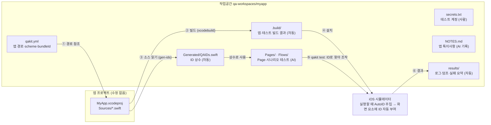

# 동작 원리

작업공간 구조, 자동 ID 규칙, 요소를 찾는 순서, 앱이 바뀌었을 때의 동작, 원칙과 한계입니다.

[← README](../README.md)

## 동작 원리

### 세 곳의 역할

| 곳 | 예시 위치 | 들어 있는 것 | 누가 바꾸나 |
|---|---|---|---|
| **앱 프로젝트** (기존 그대로) | `~/work/MyApp` | 앱 소스. **복사하지 않고 경로만 참조**합니다 | 아무도 (qakit은 읽기만) |
| **도구** (이 레포) | `~/qa-kit` | qakit CLI, 자동 ID 라이브러리, QAKit, 스킬, 템플릿 | 도구 개발자 ([docs/gitflow.md](gitflow.md)) |
| **작업공간** (앱별 QA 폴더) | `~/work/qa-workspaces/myapp` | 설정·계정·테스트·빌드 결과. git으로 관리하지 않는 일회용 | 사람(설정·계정) + AI(테스트) + qakit(자동 생성) |



<details>
<summary>그림이 안 보이는 환경(터미널 등)이면 펼치기</summary>

1. `qakit.yml`에 적힌 경로로 앱 프로젝트를 **참조만** 합니다 (복사·수정 없음).
2. 앱을 빌드하고, 결과는 작업공간의 `.build/`에 저장합니다.
3. 앱 소스를 읽어 ID 상수 `Generated/QAIDs.swift`를 만듭니다.
4. 빌드한 앱을 시뮬레이터에 설치합니다. 실행할 때 AutoID를 끼워 넣어 화면 요소에 ID를 자동으로 붙입니다.
5. AI가 만든 Page·테스트가 ID 상수로 요소를 찾아 조작합니다 (`qakit test`).
6. 로그·덤프·실패 요약은 작업공간의 `results/<날짜>/<시-분-초>_<종류>_<이름>/`(예: `14-15-16_run_home-search`, 측정은 `14-20-03_bench-1m_…`)에 실행마다 폴더로 남습니다 (`results/latest`가 마지막 실행).

</details>

<details>
<summary>자동 ID가 붙는 원리 (dylib 주입 + Mirror)</summary>

시뮬레이터에서 앱을 실행할 때 `DYLD_INSERT_LIBRARIES`로 `AutoID.dylib`를 끼워 넣습니다. 이 라이브러리는 화면이 뜰 때 ViewController·커스텀 뷰의 **저장 프로퍼티 이름**을 읽어(Swift `Mirror`) 그 뷰에 `accessibilityIdentifier`를 붙입니다. 앱 바이너리와 소스는 그대로이고, 시뮬레이터에서 qakit으로 실행할 때만 동작합니다. 규칙은 [자동으로 붙는 ID 규칙](#자동으로-붙는-id-규칙).

</details>

### 기존 프로젝트를 가져오는 방법

**앱 프로젝트는 복사하거나 고치지 않습니다.** `qakit init`이 앱 경로를 `qakit.yml`에 적어 두고, 이후 모든 명령은 그 경로를 읽기만 합니다.

| 단계 | 명령 | 앱 프로젝트에 하는 일 | 결과가 저장되는 곳 |
|---|---|---|---|
| 연결 | `qakit init ~/work/MyApp` | `xcodebuild -list`로 scheme·bundle ID 읽기 | 작업공간 생성, `qakit.yml`에 경로 기록 |
| 빌드 | `qakit build-app` | `xcodebuild build` (패키지 버전 고정, 빌드 전후 git 상태 비교 → 바뀌면 경고) | `작업공간/.build/app/` → 시뮬레이터에 설치 |
| ID 상수 | `qakit gen-ids` (`sync`·`test`가 자동 실행) | `*.swift` 읽기 (Pods·Tests 제외) | `작업공간/Runner/UITests/Generated/QAIDs.swift` |
| 실행 | `qakit test` | 없음 (설치된 앱을 실행, 자동 ID 라이브러리를 끼워 넣음) | `작업공간/results/` |
| 앱 변경 감지 | `qakit test` 시작 시 | `git` 브랜치·커밋·미커밋 변경 읽기 | `작업공간/.qakit/` (마지막 빌드 상태) |

- **다른 브랜치를 검증**하려면 앱을 옮기지 말고 그 브랜치 폴더(git worktree)를 가리킵니다: `qakit --app ~/work/MyApp-release test`. 빌드 결과는 경로별로 따로 저장됩니다.
- 같은 앱에 **작업공간을 여러 개** 만들어도 됩니다 (예: 연습용, 기능별). 작업공간을 지워도 앱에는 아무 영향이 없습니다.

### 테스트가 만들어지는 과정

| # | 누가 | 하는 일 | 만들어지는 것 |
|---|---|---|---|
| 1 | 👤 사람 | `qakit init <앱>` → `qakit.yml` 확인(권한 등) → `secrets.txt`에 계정 | 작업공간, 기본 테스트(`SmokeTests`) |
| 2 | ⚙️ qakit | `build-app`: 앱 빌드·설치·권한 허용 / `dump-ui`: 첫 화면 구조 | `.build/`, `results/ui-dump.txt` |
| 3 | 👤 사람 | AI에게 시나리오를 한 문장으로 요청: `/qa-kit 로그인 후 홈이 뜨는지 확인해줘` | — |
| 4 | 🤖 AI | `NOTES.md`·기존 공통 단계 읽기 → `QAIDs.swift`에서 화면 ID grep → 필요하면 앱 소스·덤프 확인 | — (읽기만) |
| 5 | 🤖 AI | 화면마다 Page, 시나리오 테스트, 여러 테스트가 쓸 공통 단계 작성 | `Pages/LoginPage.swift`, `Flows/LoginTests.swift`, `Flows/AuthSteps.swift` |
| 6 | 🤖 ↔ ⚙️ | `qakit test` → 실패하면 텍스트 요약(원인·마지막 단계·그 순간 화면 구조)을 읽고 수정 → 통과할 때까지 (같은 원인 3번이면 멈추고 사람에게 보고) | 통과하는 테스트 |
| 7 | 🤖 AI | 새로 알게 된 것(뜨는 팝업, 상태 판별 기준, ID 없는 영역, 사람의 결정)을 기록 | `NOTES.md` |
| 8 | 👤 사람 | 다음 시나리오 요청. AI는 이미 있는 공통 단계(예: `ensureLoggedIn()`)를 재사용 | 시나리오가 쌓일수록 빨라짐 |

> [!TIP]
> 이후에는 사람·AI 없이 `qakit test`만 반복하면 됩니다 (**토큰 0**).
> 앱이 바뀌면 `qakit test`가 먼저 재빌드·ID 재생성을 하고, 깨진 테스트는 다시 AI에게 "`qakit sync` 결과대로 고쳐줘"라고 맡깁니다.

### 누가 무엇을 만드나

| 파일 | 만드는 쪽 | 설명 |
|---|---|---|
| `qakit.yml` | qakit 초안 → 사람 확인 | 앱 경로, scheme, bundle ID, 시뮬레이터, 미리 허용할 권한 |
| `secrets.txt` | **사람만** | 테스트 계정. AI는 값을 열어 보지 않고 `QASecrets`로만 씁니다 |
| `Pages/*Page.swift` | AI | 화면 하나 = Page 하나. 화면 대표 요소(anchor)와 요소·동작. ID는 여기에만 |
| `Flows/*Tests.swift` | AI | 시나리오 테스트. Page만 사용 |
| `Flows/*Steps.swift` | AI | 여러 테스트가 쓰는 공통 단계 (로그인, 메뉴 열기 …) |
| `NOTES.md` | AI (사람도 가능) | 앱 특이사항. 다음 세션의 AI가 먼저 읽습니다 |
| `Generated/QAIDs.swift` | qakit (자동) | 앱 소스에서 만든 ID 상수. 직접 고치지 않습니다 |
| `Runner/project.yml`, `Host/`, `QAKit/` | qakit (템플릿) | 테스트 실행용 Xcode 프로젝트 틀. 손대지 않습니다 |
| `.build/`, `results/`, `.qakit/` | qakit (자동) | 빌드 결과, 로그·덤프·실패 요약, 마지막 빌드 상태 |

시나리오가 몇 개 쌓인 작업공간 예:

```text
qa-workspaces/myapp/
├── qakit.yml  secrets.txt  NOTES.md  AGENTS.md  CLAUDE.md
├── Runner/UITests/
│   ├── Pages/        LoginPage  HomePage  MenuPage  SearchPage       ← AI
│   ├── Flows/        AuthSteps  MenuSteps                            ← AI (공통 단계)
│   │                 LoginTests  MenuTests  SearchTests  SmokeTests  ← AI (시나리오)
│   ├── Generated/    QAIDs.swift                                     ← 자동
│   └── QAKit/        QAKitDumpTests.swift                            ← 템플릿
├── .build/  results/  .qakit/                                        ← 자동
```

`AGENTS.md`·`CLAUDE.md`는 작업공간을 연 AI가 스킬 규칙을 따르게 하는 안내입니다 (스킬이 설치돼 있지 않은 AI도 읽음).

---

## 자동으로 붙는 ID 규칙

ID는 **"누가 이 뷰를 프로퍼티로 갖고 있나"** 로 정해집니다.

### UIKit 화면의 ID

**어떻게 붙이나** — 앱 코드에는 손대지 않습니다. 시뮬레이터에서 끼워 넣은 `AutoID.dylib`가 UIKit 메서드에 **익스텐션으로 훅을 걸고**, 화면이 뜰 때 **`Mirror`로 저장 프로퍼티 이름을 읽어** ID로 붙입니다.

```swift
// ① dylib가 로드되면 시작 (Loader.m의 +load → QAAutoID.start)
//    UIKit 메서드를 익스텐션 메서드와 맞바꾼다 (method swizzling)
swizzle(UIViewController.self, #selector(viewDidAppear(_:)), #selector(qa_viewDidAppear(_:)))
swizzle(UIView.self,           #selector(didMoveToWindow),   #selector(qa_didMoveToWindow))

// ② 화면이 뜨면 원래 동작을 먼저 하고, ID 붙이기를 덧붙인다
extension UIViewController {
    @objc func qa_viewDidAppear(_ animated: Bool) {
        qa_viewDidAppear(animated)                 // 맞바꿨으므로 = 원래 viewDidAppear
        QAAutoID.handle(viewController: self)
    }
}
extension UIView {
    @objc func qa_didMoveToWindow() {
        qa_didMoveToWindow()                       // = 원래 didMoveToWindow
        if window != nil { QAAutoID.handle(view: self) }
    }
}

// ③ 저장 프로퍼티를 Mirror로 훑어 "타입.프로퍼티" ID를 붙인다 (하위 커스텀 뷰는 재귀)
for child in Mirror(reflecting: loginView).children {       // LoginView의 저장 프로퍼티들
    guard let name = child.label, let view = child.value as? UIView else { continue }
    if view.accessibilityIdentifier?.isEmpty ?? true {       // 앱이 붙인 ID는 덮어쓰지 않음
        view.accessibilityIdentifier = "LoginView.\(name)"   // → "LoginView.loginButton"
    }
}
```

<sub>간추린 코드입니다. 실제 구현(부모 클래스 프로퍼티, `[UIView]` 배열, 셀·탭바·검색창 처리 등): [AutoID/AutoID.swift](../AutoID/AutoID.swift)</sub>

**규칙**

| 대상 | ID | 예시 |
|---|---|---|
| VC의 뷰 프로퍼티 | `VC타입.프로퍼티` | `LoginViewController.rootView` |
| VC가 가진 커스텀 뷰의 자식 | `뷰타입.프로퍼티` | `LoginView.loginButton` |
| 커스텀 뷰 안의 커스텀 뷰 자식 | `상위ID.프로퍼티` | `LoginView.emailField.textField` |
| 앱 셀 | `셀타입` (여러 개면 라벨로 구분) | `OrderCell` |
| Collection/TableViewController의 목록 | `VC타입.collectionView` | `ListViewController.collectionView` |
| UIKit 기본 셀·섹션 헤더 | `목록ID.cell` / `.header` / `.footer` | `ListViewController.collectionView.header` |
| 탭바 버튼 | `Tab.탭첫화면VC타입` | `Tab.SettingsViewController` |
| 내비게이션 바 버튼 | 프로퍼티면 `VC.프로퍼티`, 아니면 `VC.nav.right.0` | `EditViewController.nav.right.0` |
| 검색창 입력칸 | `검색창ID.textField` | `ListView.searchBar.textField` |

- 앱이 직접 붙인 `accessibilityIdentifier`는 **절대 덮어쓰지 않습니다.**
- 테스트에서는 문자열 대신 **`QAID` 상수**를 씁니다: `QAID.LoginView.loginButton`
  - 하위 요소가 있는 컴포넌트는 `.id` (예: `QAID.LoginView.emailField.id`)
- 상수 파일(`Runner/UITests/Generated/QAIDs.swift`)은 큽니다. 필요한 화면만 찾으세요:

  ```bash
  grep -n "enum LoginView " -A30 Runner/UITests/Generated/QAIDs.swift
  ```

### SwiftUI 화면의 ID

SwiftUI는 실행 중에 읽을 프로퍼티 이름이 없습니다. 그래서:

1. **QA 워크트리에서 `qakit build-app`을 할 때** 소스에 `.accessibilityIdentifier(…)`를 끼워 넣고
2. 빌드한 뒤
3. **바로 되돌립니다.**

> [!IMPORTANT]
> - 워크트리 소스는 빌드하는 동안만 바뀌고 레포 이력에는 남지 않습니다.
> - **개발 폴더에는 절대 쓰지 않습니다.**
> - 설정: `qakit.yml`의 `swiftui: auto | insert | off` (기본 `auto` = `import SwiftUI`가 있으면 삽입)

| 대상 | ID | 예시 |
|---|---|---|
| 바인딩이 있는 컨트롤 (TextField, Toggle, Picker …) | `뷰타입.바인딩경로` | `TextField(text: $email)` → `LoginView.email` |
| 라벨이 글자인 컨트롤 (Button, NavigationLink …) | `뷰타입.종류.라벨` | `Button("로그인")` → `LoginView.Button.로그인` |
| 라벨을 소스에서 알 수 없는 컨트롤 | `뷰타입.종류.N` (등장 순서) | `Button(item.title)` → `ListView.Button.0` (상수는 `QAID.ListView.Button._0`) |
| 컨트롤 하나만 감싼 커스텀 뷰의 호출부 | `뷰타입.커스텀뷰.인자` | `IconButton(icon: .close)` → `HeaderView.IconButton.close` |
| ForEach/List 행 | `뷰타입.row` (여러 행이 같은 ID, 라벨·index로 구분) | `ItemListView.row` |

- **이름 규칙** — 같은 ID가 한 뷰에 둘 이상이면 `_2`, `_3`. 라벨은 공백·구두점이 `_`로 바뀌고 20자에서 잘립니다.
- **붙이지 않는 곳** — 앱이 직접 붙인 `accessibilityIdentifier`가 있는 요소. Text·Image·VStack 같은 컨테이너 (컨테이너 ID는 자식 ID를 덮어씁니다).
- **확인 방법** — 삽입될 목록은 `qakit swiftui-ids --list`. 삽입된 소스를 직접 보려면 `--insert` 뒤 `git diff`, 끝나면 `--restore`.
- **Tuist처럼 프로젝트를 생성하는 앱** — 워크트리에서 먼저 생성한 뒤 `qakit init`을 합니다. `ids.sources`로 빌드되는 모듈 폴더만 지정하세요 (보관용 복사본 폴더가 있으면 같은 타입 이름이 섞입니다).

---

## UI 요소를 찾는 우선순위

테스트는 **기본적으로 키(ID)로 찾고**, ID가 없을 때만 화면에 보이는 것(글자 → 좌표)으로 내려갑니다.
위에 있을수록 앱 문구·레이아웃이 바뀌어도 잘 깨지지 않습니다. AI도 스킬 규칙으로 이 순서를 따릅니다.

| 순위 | 무엇으로 | 코드 예 | 쓰는 경우 | 약점 |
|---|---|---|---|---|
| 1 | **자동 ID 상수** (프로퍼티 이름) | `el(QAID.LoginView.loginButton)` | 대부분. 앱 코드에 프로퍼티로 있는 뷰 | 앱에서 프로퍼티 이름을 바꾸면 깨짐 → `qakit sync`가 컴파일 에러로 바로 알려 줌 |
| 2 | **위치 규칙 ID** | `app.buttons["Tab.SettingsViewController"]`<br>`QAID.X.collectionView + ".header"` | 탭바·기본 셀·헤더·바 버튼·검색창 (UIKit이 만드는 요소) | 상수가 없어 문자열로 씀 |
| 3 | **ID + 화면 글자** | `cell(QAID.ItemCell.id, labelID: QAID.ItemCell.titleLabel, label: "검색")` | 같은 ID가 여러 개 (목록 셀, 반복 컴포넌트) | 글자가 바뀌면 깨짐 |
| 4 | **화면 글자** (라벨) | `text("확인")`, `app.buttons["로그인"]` | ID가 없는 요소: 지역 변수로 만든 뷰, 외부 SDK 버튼, 시스템 알림 | 문구·언어가 바뀌면 깨짐 (그래서 `qakit.yml`의 `language`로 언어를 고정) |
| 5 | **타입 + 순서** | `app.cells.element(boundBy: 0)` | "첫 번째 항목"처럼 순서 자체가 시나리오일 때 | 데이터 순서가 바뀌면 깨짐 |
| 6 | **좌표** | `app.coordinate(withNormalizedOffset: CGVector(dx: 0.5, dy: 0.5)).tap()` | 지도·차트·캔버스처럼 그려지는 영역 (안에 요소가 없음) | 화면 크기·레이아웃에 민감. 결과 확인은 그 위의 UI로 |

> [!NOTE]
> **스크린샷은 찾는 수단이 아닙니다.** 덤프로도 판단이 안 될 때 사람이나 AI가 상황을 이해하는 용도로만 봅니다 (실패 요약에 경로가 나옵니다). 테스트 코드는 항상 위 1~6으로 씁니다.

### 화면에 보이는 것은 어떻게 읽나

픽셀(스크린샷)을 읽는 게 아닙니다. XCUITest는 iOS가 VoiceOver용으로 만드는 **접근성 트리**를 읽습니다. 화면의 요소 하나하나가 트리의 노드이고, 노드마다 아래 값이 있습니다.

| 노드의 값 | 어디서 오나 | 순위 |
|---|---|---|
| `identifier` | `accessibilityIdentifier` (앱이 붙였거나 AutoID가 자동으로 붙인 ID) | 1~3 |
| `label` | `UILabel.text`, 버튼 제목, 텍스트필드 placeholder·값, `accessibilityLabel`처럼 **화면에 보이는 글자** | 3, 4 |
| `elementType` | UIKit 클래스에서 정해지는 종류 (`Button`, `StaticText`, `Cell`, `TextField` …) | 5 |
| `frame` | 화면 위 위치·크기 (pt) | 6 |
| `isSelected`, `value`, `isHittable` 등 | 선택 상태, 스위치·슬라이더 값, 누를 수 있는지 | 판정용 |

테스트는 이 값으로 **조건을 걸어** 요소를 찾습니다.

```swift
app.descendants(matching: .any).matching(identifier: "LoginView.loginButton")   // 1. identifier로
app.descendants(matching: .any).matching(NSPredicate(format: "label == %@", "확인"))  // 4. label로 = text("확인")
app.cells.matching(identifier: "ItemCell")                                       // 3. ID + 그 안 label로 한 개 고르기
    .containing(NSPredicate(format: "identifier == %@ AND label == %@", "ItemCell.titleLabel", "검색"))
app.cells.element(boundBy: 0)                                                     // 5. 종류 + 순서로
app.coordinate(withNormalizedOffset: CGVector(dx: 0.5, dy: 0.5)).tap()            // 6. 화면 비율 좌표로
```

`qakit dump-ui`는 같은 트리를 `app.snapshot()`으로 한 번에 떠서 한 줄씩 텍스트로 보여 줍니다. 그래서 덤프에 나온 값이 곧 테스트에서 쓸 수 있는 값입니다.

```text
Button #LoginView.loginButton "로그인" @16,682 370x56
└─종류  └─identifier          └─label  └─frame (x,y 너비x높이)
```

> [!NOTE]
> - 지도·차트처럼 **그려지는 영역**은 안쪽이 노드 하나라 글자·요소가 트리에 없습니다 → 좌표(6순위)를 씁니다.
> - `isHidden` 뷰나 팝업에 가려진 뷰는 트리에서 빠집니다. 덤프에 안 보이면 테스트도 찾을 수 없습니다.
> - 글자는 언어에 따라 바뀌므로 `qakit.yml`의 `language`·`locale`로 고정합니다.

### AI가 요소를 알아내는 순서

싼 것부터 씁니다.

| 순서 | 방법 | 비용 |
|---|---|---|
| 1 | `QAIDs.swift`에서 화면 enum만 grep → 순위 1 상수 확보 | 매우 적음 |
| 2 | 앱 소스에서 버튼 → 액션 → 화면 전환 확인 (push / 시트 / 탭, 토글 여부, 위험한 버튼 위치) | 적음 |
| 3 | `qakit do`로 한 단계씩 눌러 가며 `qakit do dump` 텍스트 덤프 → 실제 ID·글자·좌표·커버리지·화면 전환 (순위 2~6이 필요한 화면) | 적음 (단계당 1~2초, 스크린샷보다 훨씬 작음) |
| 4 | 실패 요약 속 스크린샷 | 큼 (덤프로 판단이 안 될 때만) |

### 찾은 뒤 상태 판정하기

찾는 것과 판정은 다릅니다. 상황에 맞는 판정을 씁니다.

| 알고 싶은 것 | 쓰는 것 | 주의 |
|---|---|---|
| 화면이 떴나 | `page.isDisplayed(timeout:)` (anchor 존재) | — |
| 정말 화면 안에 보이나 | `isVisibleOnScreen` | 하단 시트·드로어는 닫혀도 화면 밖에 남아 `exists`가 true |
| 닫혔나 | `page.waitUntilGone()` | 사라짐 또는 화면 밖 |
| 선택됐나 (탭·세그먼트) | `element.isSelected` | — |
| 선택 표시가 있나 (배지 등) | 그 표시 요소가 **있는지** | 숨긴(`isHidden`) 뷰는 접근성 구조에서 빠지므로 "없음 = 숨김" |
| 여러 후보 중 먼저 뜬 것 | `QAWait.forAny([...])` | 로그인 화면 vs 홈 화면처럼 분기할 때 |

---

## 앱이 바뀌었을 때

**따로 할 일이 거의 없습니다.** `qakit test`가 실행 전에 앱 상태(경로·브랜치·커밋·미커밋 변경)를 마지막 빌드와 비교하고, 바뀌었으면 **재빌드 → ID 재생성**을 먼저 합니다.

```text
🔄 앱 변경 감지 (브랜치 develop → feature/new-login) → 동기화
   ID 변경: 추가 1, 삭제 1
     - LoginView.loginButton
     + LoginView.signInButton
❌ Runner/UITests/Pages/LoginPage.swift:5: 'QAID.LoginView' has no member 'loginButton'
```

| 하고 싶은 것 | 방법 |
|---|---|
| 깨진 테스트 고치기 | 삭제·추가 목록을 보고 Page의 상수만 바꾸면 됩니다 (AI에게 "`qakit sync` 결과대로 테스트 고쳐줘") |
| 다른 브랜치 폴더(git worktree) 검증 | `qakit --app ~/path/MyApp-release test` |
| 자동 동기화 끄기 | `qakit.yml`에 `sync: warn` (알리기만) 또는 `off` |

### QA 워크트리 최신화

QA 워크트리(`qa/workspace`)는 **한 번 만들면 계속 유지**합니다. 개발 브랜치(`develop`)가 앞서 나가면 그 커밋을 **QA 워크트리 쪽으로 가져와** 최신 앱으로 테스트합니다.

```text
develop       ──●──●──●──●──●
                 \         \  가져오기 (merge)
qa/workspace      ●──●──●───●   ← QA 결과물은 여기 그대로
```

| 하는 것 (기본) | 하지 않는 것 |
|---|---|
| `qakit test`·`qakit run` 전에 `develop`(원격이 앞서면 `origin/develop`)보다 뒤처졌는지 확인 → 뒤처졌으면 가져오기 → 바뀐 앱으로 재빌드 | QA 브랜치를 `develop` 등 다른 브랜치로 **병합하지 않습니다** (사용자가 명시적으로 요청할 때만) |
| 앱 소스에 미커밋 변경이 있거나 충돌이 나면 **가져오지 않고 알려 줌** (충돌은 자동으로 되돌림) | **push하지 않습니다** |

```bash
qakit worktree-update --check      # 뒤처졌는지만 확인 (doctor도 알려 줌)
qakit worktree-update              # 지금 가져오기
qakit worktree-update --from release/1.2.0   # 다른 브랜치를 따라가기
```

```yaml
# qakit.yml
worktree:
  base: develop      # 따라갈 브랜치. release/* → 버전이 가장 높은 release 브랜치 (새 릴리스 브랜치가 생기면 자동으로 그쪽)
  update: auto       # auto: test/run 전에 자동 / warn: 알리기만 / off
```

## 원칙

| 원칙 | 내용 |
|---|---|
| 🔒 **대상 앱 레포를 수정하지 않습니다** | 빌드할 때도 `Package.resolved`를 고치지 않도록 고정하고, 빌드 전후로 앱 레포에 바뀐 파일이 있으면 경고합니다 |
| 🔑 **비밀값은 `secrets.txt`에만** | 테스트 출력·로그·실패 요약에서 비밀값은 `•••`로 가려집니다 |
| ⚠️ **되돌릴 수 없는 동작은 승인 후에만** | 탈퇴·결제·삭제·실제 전송은 사람이 승인한 경우에만 테스트에 넣고 `NOTES.md`에 기록합니다 |
| 🌿 **QA 워크트리는 유지하고 병합하지 않습니다** | 다른 브랜치가 앞서면 그 커밋을 QA 워크트리로 가져올 뿐, QA 브랜치를 다른 브랜치로 병합하거나 push하지 않습니다 (사용자가 명시적으로 요청할 때만) |
| 🧩 **테스트끼리 상태를 공유하지 않습니다** | 공통 진입(로그인 등)은 `Flows/*Steps.swift`에 한 번만 만들어 재사용합니다 |

> [!CAUTION]
> Xcode 결과 파일 `results/…/result.xcresult`에는 **입력 기록이 남으니 공유하지 마세요.** (`results/`는 git에서 제외됩니다.)

---

## 한계

| 경우 | 대신 |
|---|---|
| 지역 변수로 만든 뷰 (`let label = UILabel(); addSubview(label)`) | 화면 글자로 찾기: `text("확인")` |
| 외부 SDK가 내부에서 만든 뷰 (예: 지도 SDK의 버튼) | 화면 글자 또는 좌표 |
| 지도·차트·캔버스처럼 그려지는 영역 | 좌표로 조작, 결과는 그 위의 UI로 확인 |
| SwiftUI 화면 | `qakit init --worktree`로 만든 QA 워크트리에서만 ID가 붙음 (개발 폴더 소스는 안 건드림). 시스템 기본 뒤로가기·동적 라벨 버튼은 라벨·순서 번호로 |
| 안드로이드 | 시나리오 실행(`run`·`do`)·`build-app`까지 됨. Compose 화면은 앱에 testTag가 있어야 ID로 찾음(없으면 글자로). 실패 영상·`--bench`·AI QA는 아직 ([설계](PLAN.md#안드로이드-지원-설계-진행-중)) |
| 실기기 | `--device`로 시나리오·`--bench`는 된다 ([실기기에서 실행](device.md)). 상주 실행기(`qakit serve`·`qakit do`)도 USB·Wi-Fi 모두. Swift 테스트(`qakit test`)와 권한 미리 허용은 아직 시뮬레이터만 |

문제가 생기면: [troubleshooting.md](../skills/qa-kit/references/troubleshooting.md)
