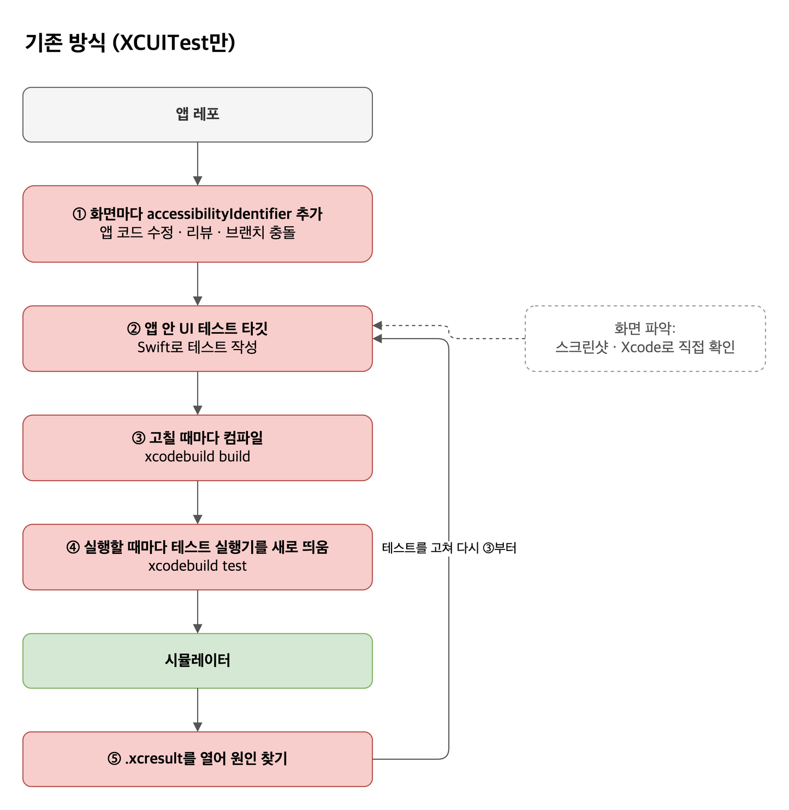
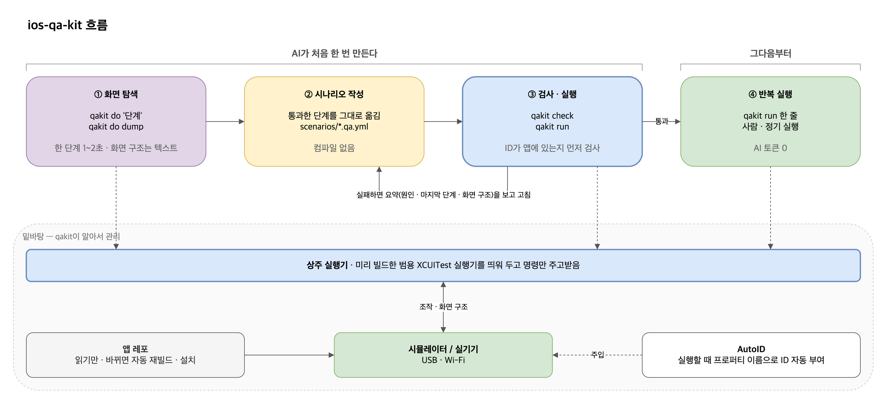
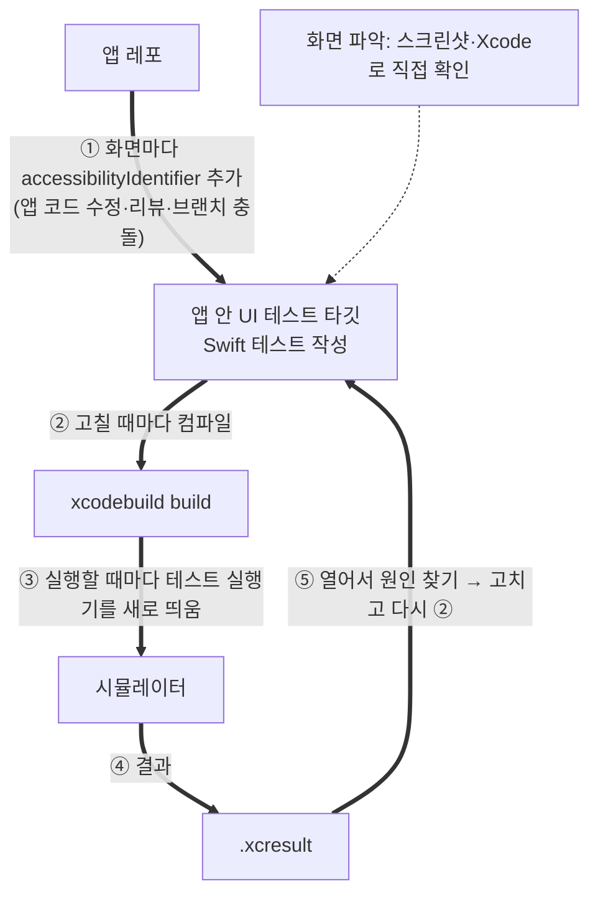
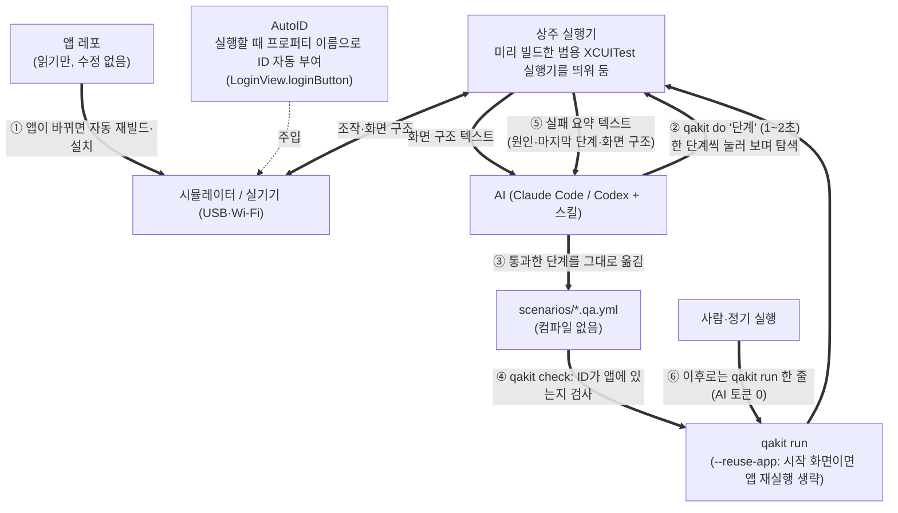

# 왜 qa-kit인가 · 구조

XCUITest만 쓸 때와 무엇이 다른지, 시나리오 파일이 왜 컴파일 없이 도는지 설명합니다.

[← README](../README.md)

## 한눈에 보기

| 무엇을 | 어떻게 |
|---|---|
| **화면 요소 찾기** | 시뮬레이터에서 실행할 때 라이브러리를 끼워 넣어 `LoginView.loginButton` 같은 **ID를 자동으로** 붙입니다 (Swift 프로퍼티 이름 기반) |
| **앱 변경에 강하게** | 앱 소스에서 ID를 **Swift 상수(`QAID`)** 로 만들어, 이름이 바뀌면 컴파일 에러로 바로 알려 줍니다 |
| **실행·실패 분석** | `qakit` 명령 하나로 빌드·설치·실행·실패 요약까지. 요약은 텍스트라 AI가 스크린샷 없이 고칩니다 |
| **AI 작업** | Claude Code / Codex **스킬**: "이 시나리오 테스트 만들어줘" → 작성하고 통과할 때까지 수정 |

## 구조 한눈에 보기

### 기존 방식 (XCUITest만)

<p align="center"></p>

### qa-kit

<p align="center"></p>

그림 원본: [`docs/images/architecture-before.drawio`](images/architecture-before.drawio), [`architecture-qakit-flow.drawio`](images/architecture-qakit-flow.drawio) (draw.io로 열어 고친 뒤 PNG로 내보냄)

<!-- Mermaid 원본 (그림은 docs/images/*.drawio에서 PNG로 바꿈). HTML 주석은 대시 두 개와 꺾쇠가 붙은 곳에서 끝나므로, 화살표는 같은 뜻의 굵은 화살표(==>)로 적어 둠.




-->

<details>
<summary>그림이 안 보이는 환경(터미널 등)이면 펼치기</summary>

**기존 방식 (XCUITest만)**

1. 앱 코드의 화면마다 `accessibilityIdentifier`를 붙입니다. 앱 코드 수정·리뷰가 필요하고 브랜치마다 충돌합니다.
2. 앱 안에 UI 테스트 타깃을 만들고 Swift로 테스트를 씁니다. 고칠 때마다 컴파일합니다.
3. 실행할 때마다 `xcodebuild`가 테스트 실행기를 새로 띄웁니다.
4. 실패하면 `.xcresult`를 열어 원인을 찾고, 고치고, 다시 빌드합니다.

**qa-kit**

1. 앱 레포는 읽기만 합니다. 앱이 바뀌면 qakit이 다시 빌드·설치하고, 실행할 때 AutoID가 프로퍼티 이름으로 ID를 붙입니다.
2. AI가 `qakit do '단계'`로 떠 있는 실행기(상주 실행기)에 한 단계씩 보내며 화면을 탐색합니다 (단계당 1~2초, 화면 구조는 텍스트).
3. 통과한 단계를 그대로 시나리오 파일(`.qa.yml`)에 옮깁니다. 컴파일하지 않습니다.
4. `qakit check`가 ID가 앱에 있는지 검사하고, `qakit run`이 같은 실행기로 돌립니다. `--reuse-app`이면 앱이 이미 시작 화면일 때 다시 켜지 않습니다.
5. 실패하면 원인·마지막 단계·그 순간 화면 구조를 텍스트로 돌려줍니다. AI는 이것만 보고 고칩니다.
6. 만든 뒤에는 사람이나 정기 실행이 `qakit run` 한 줄로 돌립니다. AI 토큰은 들지 않습니다.

</details>

**시범 앱(SwiftUI) 홈 시나리오 11개를 차례로 돌린 시간** (시뮬레이터, 2026-11-07)

| 방식 | 합계 |
|---|---|
| 시나리오마다 `xcodebuild`로 실행기를 새로 띄움 (qakit 0.12, XCUITest를 그대로 돌리는 방식) | 322초 |
| 상주 실행기 (qakit 0.14.2) | 252초 |
| 상주 실행기 + `--reuse-app` (qakit 0.16) | 82초 |

## 왜 qa-kit인가

XCUITest는 Apple이 주는 **UI 테스트 엔진**입니다. 엔진은 좋지만, 실제 앱에 붙여 계속 쓰려면 준비할 게 많습니다. qa-kit이 그 준비를 대신합니다.

**같은 테스트("로그인하면 홈 화면이 뜬다")를 만들 때**

```text
XCUITest만   앱 코드에 ID 추가 → 앱에 UI 테스트 타깃 추가 → 테스트 코드 작성
             → xcodebuild로 실행 → 실패하면 .xcresult를 열어 원인 찾기 → 고치고 다시 빌드

qa-kit   "/qa-kit 로그인하면 홈이 뜨는지 확인해줘" (AI가 작성 → 실행 → 통과할 때까지 수정)
             → 다음부터는 qakit run 한 줄
```

### 1. 앱 코드를 고치지 않아도 됩니다

XCUITest로 버튼을 안정적으로 찾으려면 앱 코드에 ID를 붙여야 합니다.

```swift
// XCUITest만 쓸 때: 앱 코드(LoginView.swift)에 직접 추가
loginButton.accessibilityIdentifier = "loginButton"
```

qa-kit은 **프로퍼티 이름을 그대로 ID로** 붙입니다. 앱에는 아무것도 추가하지 않습니다.

```swift
// 앱 코드는 그대로
let loginButton = UIButton()
// → 테스트에서 QAID.LoginView.loginButton 으로 찾음
```

### 2. 앱이 바뀌면 깨진 곳을 바로 알려 줍니다

앱에서 `loginButton`을 `signInButton`으로 바꾸면, 테스트를 돌리기 전에 위치까지 알려 줍니다.

```text
🔄 앱 변경 감지 → 재빌드
   - LoginView.loginButton
   + LoginView.signInButton
❌ Pages/LoginPage.swift:5: 'QAID.LoginView' has no member 'loginButton'
```

### 3. 실패 원인을 텍스트로 바로 읽습니다

`.xcresult`를 열지 않아도 됩니다. 사람도 AI도 이것만 보고 고칩니다.

```text
❌ LoginTests/test_login()
   원인: 로그인 후 홈 화면이 뜨지 않음. 화면 안내: 팝업: 이미 다른 기기에서 로그인 중입니다…
   마지막 단계: 로그인 입력
```

### 4. 한 번 만들면 AI 없이 계속 돌립니다

- computer use(스크린샷 보며 조작)는 **돌릴 때마다** AI 비용이 듭니다.
- qa-kit은 AI가 **처음 한 번** 만들어 두면 이후는 `qakit run` 한 줄이고 **토큰 0**입니다.
- 시나리오 파일은 [컴파일 없이](#시나리오-파일에-컴파일이-필요-없는-이유) 바로 돌고, 값만 바꿔 다시 실행할 수 있습니다.

  ```bash
  qakit run search-favorite --var item=라떼
  ```

<details>
<summary>XCUITest만 쓸 때와 항목별 비교</summary>

| XCUITest만 쓰면 | qa-kit을 쓰면 |
|---|---|
| **요소에 ID를 붙이려면 앱 코드를 고쳐야 합니다.** 화면마다 `accessibilityIdentifier`를 넣어야 하고, 없으면 글자·순서로 찾아 쉽게 깨집니다 | 시뮬레이터에서 실행할 때 **프로퍼티 이름으로 ID가 자동으로** 붙습니다 (`LoginView.loginButton`). 앱 코드는 한 줄도 고치지 않습니다 |
| ID를 문자열로 써서, 앱에서 이름이 바뀌면 **실행해 봐야** 깨진 걸 압니다 | ID를 Swift 상수(`QAID`)로 만들어 줍니다. 이름이 바뀌면 **컴파일 에러**로 바로 위치를 알려 줍니다 |
| UI 테스트 타깃을 **앱 프로젝트 안에** 만들어야 해서 앱 레포에 QA 코드가 섞입니다 | 테스트용 Xcode 프로젝트가 **작업공간에 따로** 있습니다. 앱 레포는 읽기만 합니다 |
| 실행·결과 확인이 `xcodebuild` 옵션과 `.xcresult` 분석이라 손이 많이 갑니다 | `qakit test` 한 줄로 빌드·설치·실행. 실패하면 **원인·마지막 단계·그 순간 화면 구조를 텍스트로** 요약합니다 |
| 앱 브랜치가 바뀌면 다시 빌드하고 깨진 곳을 직접 찾아야 합니다 | 실행 전에 앱 변경을 감지해 **재빌드 → ID 재생성**을 먼저 하고, 바뀐 ID 목록을 보여 줍니다 |
| 시나리오마다 Swift 코드를 짜고 컴파일해야 합니다 | **시나리오 파일(`.qa.yml`)** 로 쓸 수 있습니다. [컴파일이 필요 없고](#시나리오-파일에-컴파일이-필요-없는-이유), `--var`로 값(검색어 등)을 바꿔 실행합니다 |

</details>

### 그대로인 것

- 테스트 엔진은 XCUITest입니다. Swift로 직접 XCUITest를 써도 되고, 시나리오 파일과 같은 작업공간에서 함께 씁니다.
- 자동 ID는 시뮬레이터와 실기기(`--device`) 모두 됩니다. 실기기는 qakit이 AutoID를 앱 안에 넣고 다시 서명해서 설치합니다.

### AI가 브랜치에서 accessibilityIdentifier를 붙이면 되지 않나?

한 번은 됩니다. 문제는 **계속 유지하는 비용**입니다.

| | 브랜치에서 `accessibilityIdentifier` 직접 추가 | AutoID (qa-kit) |
|---|---|---|
| 처음 작업 | 화면마다 수백~수천 곳 수정 | 0줄 |
| develop이 바뀔 때 | 브랜치를 계속 맞춰야 하고, 같은 파일을 고친 커밋마다 충돌 | 영향 없음. 어떤 커밋이든 그대로 빌드 |
| 새 화면이 생기면 | 그때마다 다시 붙여야 함 (빠뜨리면 테스트가 못 찾음) | 자동으로 붙음 |
| 예전 커밋·다른 브랜치 검증 | 그 브랜치에도 같은 작업 | `qakit --app <폴더>`로 바로 |
| 이름 규칙 | 사람마다, 작업마다 달라질 수 있음 | 항상 `타입.프로퍼티` (예: `LoginView.loginButton`). 바뀌면 실행 전에 알려 줌 |
| 앱 레포 | 테스트용 코드가 섞이고 리뷰 부담 | 그대로 |

**팀이 테스트용 ID를 앱에 정식으로 넣기로 합의했다면** 그게 가장 튼튼합니다. 앱이 직접 붙인 ID가 있으면 qa-kit은 그걸 그대로 씁니다 (AutoID는 앱의 ID를 덮어쓰지 않음). AutoID는 그 합의와 유지 없이 바로 시작하게 해 주는 부분입니다.

그리고 ID는 일부일 뿐입니다. ID를 앱에 직접 붙여도 아래는 따로 필요합니다.

- 시나리오 파일(`.qa.yml`)을 컴파일 없이 돌리는 실행기
- 실패 원인·마지막 단계·그 순간 화면 구조 요약
- `--bench` 성능 측정 (CPU·메모리·함수별 CPU, 한글 요약)
- `--device` 실기기 서명·설치·실행
- QA 워크트리를 develop에 맞춰 최신화

qa-kit의 필요성은 "ID 붙이기"보다 **QA를 누구나 같은 명령으로 반복할 수 있게 만드는 것**에 있습니다.

### 시나리오 파일에 컴파일이 필요 없는 이유

**테스트 코드는 미리 한 번만 컴파일해 두고, 시나리오(`.qa.yml`)는 그 코드가 실행할 때 읽는 데이터로 넘깁니다.** 그래서 시나리오를 고쳐도 다시 빌드하지 않습니다. 게임 엔진은 그대로 두고 맵 파일만 바꾸는 것과 같습니다.

**① 미리 컴파일해 둔 것: 범용 실행기**

도구 안에 앱과 상관없는 XCUITest 테스트가 하나 있습니다 (`ScenarioTests.test_run` + `QAScenarioRunner`).
`qakit run`을 처음 할 때 `xcodebuild build-for-testing`으로 한 번 빌드해 두고(`.xctestrun`), 이후로는 **도구가 바뀌었을 때만** 다시 빌드합니다 (소스 해시로 판단). 앱이 여러 개여도 이 실행기 하나를 같이 씁니다.

**② 실행할 때: yml → JSON → 실행기에 전달**

```text
scenarios/login.qa.yml
   │  qakit이 읽어서: use: 로 쓴 공통 단계를 펼치고, --var 값을 넣고, ID가 앱에 있는지 검사
   ▼
.qakit/scenarios/login.json
   │  환경변수로 경로를 넘김 (실기기는 Mac 파일을 못 읽어서 내용째 base64로)
   ▼
xcodebuild test-without-building   ← 빌드 없이 미리 만든 실행기만 실행
   ▼
QAScenarioRunner가 JSON을 한 단계씩 읽어 XCUITest 동작으로
```

**③ 실행기 안: 단계 이름 → XCUITest 호출**

```yaml
# 시나리오 (데이터)
- tap: LoginView.loginButton
- type: { into: LoginView.emailField, text: "{secret:EMAIL}" }
- expect: { visible: HomeView.title }
  timeout: 10
```

```swift
// 실행기 (미리 컴파일된 코드) — 단계마다 키를 보고 같은 동작을 부른다
if let target = step["tap"] {            // "LoginView.loginButton"
    resolve(target).tap()                //   → app.descendants(…)["LoginView.loginButton"].tap()
} else if let spec = step["type"] {
    resolve(spec["into"]).typeText(text(spec["text"]))
} else if let condition = step["expect"] {
    try waitUntil(condition, timeout: step["timeout"])
} …
```

대상(ID·라벨)과 값(`{변수}`, `{secret:…}`)은 컴파일할 때가 아니라 **실행할 때** 문자열로 찾고 채웁니다. 그래서 시나리오 내용이 바뀌어도 실행기 코드는 그대로입니다.

| | Swift 테스트 | 시나리오 파일 |
|---|---|---|
| 무엇을 빌드하나 | 테스트를 고칠 때마다 그 테스트 코드 | 도구의 **범용 실행기 하나** |
| 언제 빌드하나 | 고칠 때마다 | **도구가 바뀌었을 때 한 번만** |
| 앱마다 | 앱별 테스트 프로젝트 | 모든 앱이 같은 실행기를 씀 |
| 시나리오를 고친 뒤 | 다시 빌드 → 실행 | **바로 실행** |

- 컴파일 에러가 해 주던 확인은 `qakit check`가 대신합니다. 형식과 ID가 앱에 실제로 있는지를 실행 없이 검사합니다 (`qakit run`도 실행 전에 먼저 검사).
- 실행기가 모르는 동작이 필요하면 도구에 단계를 하나 추가합니다 (예: `pinch-to`). 그때만 실행기를 다시 빌드합니다.
